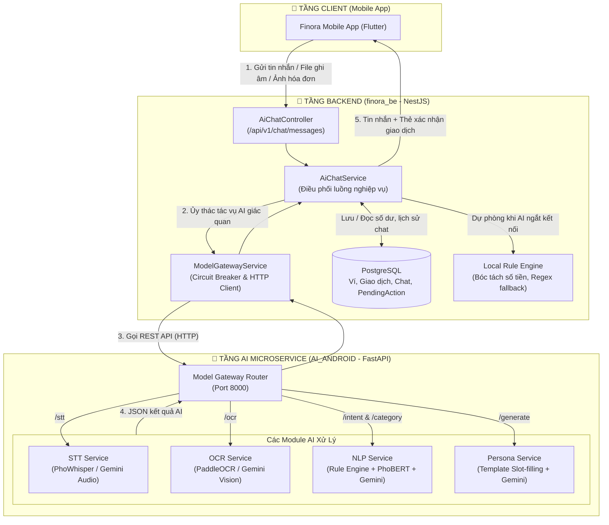
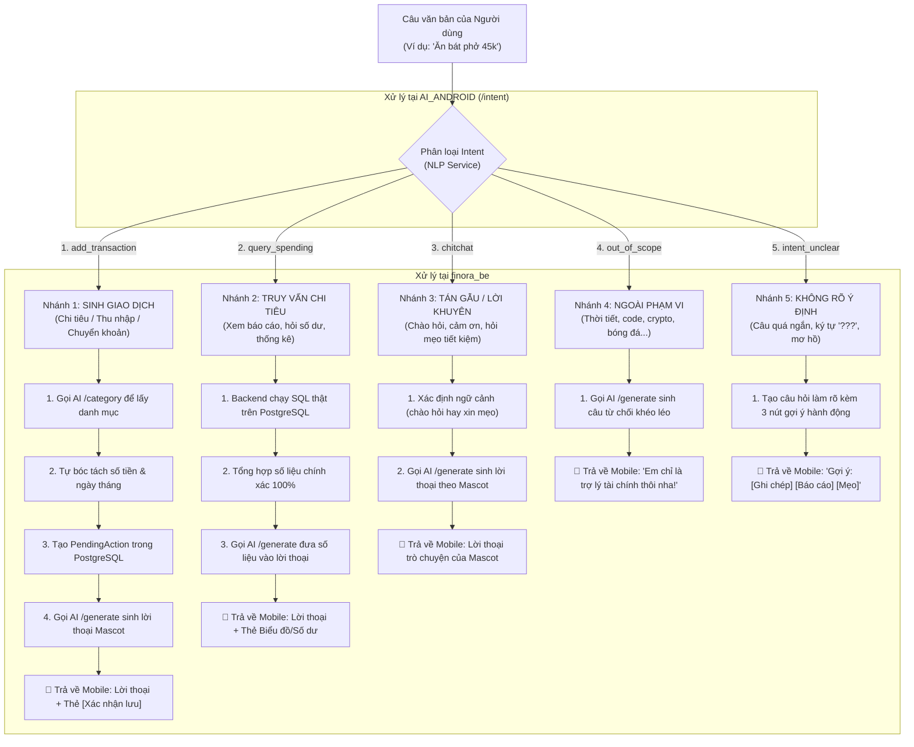
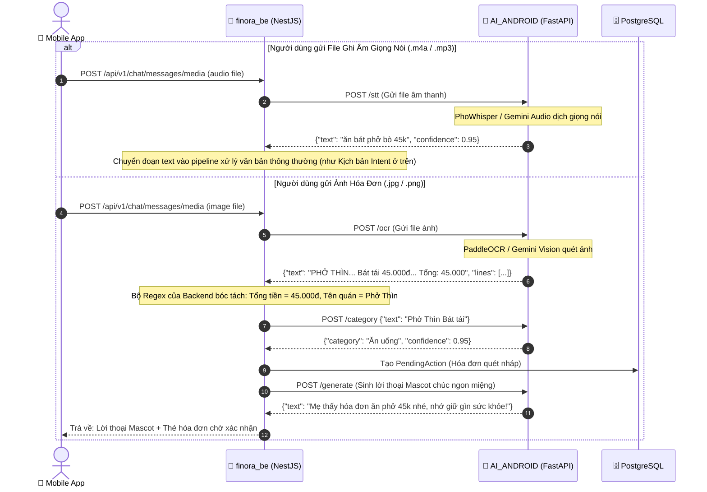

# 🏛️ Kiến Trúc Hệ Thống & Luồng Dữ Liệu AI: FINORA_BE ⟷ AI_ANDROID

Tài liệu này mô tả chi tiết kiến trúc tích hợp, phân định trách nhiệm xử lý giữa **Backend (`finora_be`)** và **AI Microservice (`AI_ANDROID`)**, cùng sơ đồ luồng dữ liệu hoàn chỉnh cho 5 nhánh Intent và xử lý Đa phương tiện (Voice/OCR).

---

## 1. 📌 Bảng Phân Định Trách Nhiệm (Backend vs AI Service)

| Hạng mục công việc | Xử lý tại Backend (`finora_be` - NestJS) | Xử lý tại AI Service (`AI_ANDROID` - FastAPI) |
|---|---|---|
| **Xác thực & Bảo mật** | • Xác thực JWT, phân quyền truy cập ví, kiểm tra quyền sở hữu dữ liệu người dùng.<br>• Rate limiter chống spam request. | • Chỉ nhận request xử lý nội bộ từ Backend qua mạng private/localhost. |
| **Nhận diện Giọng nói (STT)** | • Kiểm tra định dạng audio (`.m4a`, `.mp3`) và dung lượng tệp ($\le 10$MB). | • Chạy mô hình **PhoWhisper / Gemini Audio** để chuyển âm thanh thành văn bản tiếng Việt. |
| **Đọc ảnh Hóa đơn (OCR)** | • Kiểm tra định dạng ảnh và dung lượng tệp ($\le 5$MB).<br>• Bóc tách số tiền tổng và ngày tháng từ text hóa đơn. | • Chạy mô hình **PaddleOCR / Gemini Vision** quét ảnh và trả về toàn bộ các dòng chữ. |
| **Phân loại Ý định (Intent)** | • Điều phối logic rẽ nhánh theo kết quả Intent.<br>• Có lớp Regex fallback nội bộ nếu AI Service bận. | • Chạy mô hình NLP phân loại chính xác vào **5 nhánh chuẩn** (`add_transaction`, `query_spending`, `chitchat`, `out_of_scope`, `intent_unclear`). |
| **Phân loại Danh mục (Category)**| • Gán ID danh mục trong database ví người dùng.<br>• Có từ điển mapping nội bộ dự phòng. | • Phân tích ngữ nghĩa món hàng/dịch vụ để gán vào danh mục phù hợp (*Ăn uống, Di chuyển, Mua sắm...*). |
| **Tính toán & Dữ liệu tài chính**| • **100% tính toán số dư, ngân sách, thống kê SQL trên PostgreSQL.**<br>• Tuyệt đối không để AI tự tính toán (tránh ảo giác sai số tiền). | • Không lưu database, không can thiệp số dư tiền thật. |
| **Sinh lời thoại Mascot (NLG)** | • Nạp ngữ cảnh tài chính của User (số dư, ngân sách tháng, linh thú theo tầng tài sản ròng). | • Đóng vai **7 Mascot chuẩn của Finora** (*Ash, Penny, Sage, Nora, Jade, Ruby, Bellingham*) tương ứng từng tầng Net Worth để sinh câu phản hồi tài chính chuẩn tính cách. |
| **Lưu trữ & Phê duyệt (HITL)** | • Quản lý vòng đời **PendingAction** (chờ người dùng xác nhận trước khi lưu sổ cái).<br>• Lưu lịch sử chat vào bảng `chat_messages`. | • Không trạng thái (Stateless). |

---

## 2. 🏗️ Sơ Đồ Kiến Trúc Tổng Thể (System Architecture)



---

## 3. 🔄 Sơ Đồ Chi Tiết 5 Nhánh Intent

Khi người dùng gửi câu văn bản hoặc sau khi dịch giọng nói thành văn bản, Backend sẽ gửi câu sang AI Service qua `POST /intent`. Luồng xử lý rẽ nhánh như sau:



---

## 4. 🎙️🖼️ Sơ Đồ Xử Lý Đa Phương Tiện (Voice STT & Receipt OCR)

Khi người dùng gửi file ghi âm hoặc ảnh chụp hóa đơn lên `POST /api/v1/chat/messages/media`:



---

## 5. 🔌 Chi Tiết Hợp Đồng Giao Tiếp API (API Contracts)

Cả hai hệ thống giao tiếp qua giao thức REST HTTP (chuẩn JSON và multipart/form-data) trên cổng `http://localhost:8000`:

### 1. `POST /ocr`
* **Input (multipart/form-data):** `file: UploadFile` (ảnh hóa đơn).
* **Output (JSON):**
  ```json
  {
    "text": "Nội dung đầy đủ đọc từ hóa đơn...",
    "lines": ["Dòng 1", "Dòng 2", "Dòng 3"],
    "confidence": 0.95,
    "engine": "paddleocr"
  }
  ```

### 2. `POST /stt`
* **Input (multipart/form-data):** `file: UploadFile` (âm thanh giọng nói).
* **Output (JSON):**
  ```json
  {
    "text": "nội dung người dùng vừa nói",
    "transcript": "nội dung người dùng vừa nói",
    "confidence": 0.92
  }
  ```

### 3. `POST /intent`
* **Input (JSON):**
  ```json
  { "text": "ăn bát phở bò 45k" }
  ```
* **Output (JSON):**
  ```json
  {
    "intent": "add_transaction",
    "confidence": 0.95
  }
  ```
  *(Các giá trị intent: `add_transaction`, `query_spending`, `chitchat`, `out_of_scope`, `intent_unclear`)*

### 4. `POST /category`
* **Input (JSON):**
  ```json
  { "text": "ăn bát phở bò 45k" }
  ```
* **Output (JSON):**
  ```json
  {
    "category": "Ăn uống",
    "confidence": 0.95
  }
  ```

### 5. `POST /generate`
* **Input (JSON):**
  ```json
  {
    "persona": "strict_mom",
    "balance": 50000,
    "budget": 5000000,
    "amount": 45000,
    "category": "Ăn uống"
  }
  ```
* **Output (JSON):**
  ```json
  {
    "text": "Mẹ nhìn cái số dư mà xót hết cả ruột! Bớt trà sữa với mua sắm linh tinh lại ngay cho mẹ!",
    "message": "Mẹ nhìn cái số dư mà xót hết cả ruột! Bớt trà sữa với mua sắm linh tinh lại ngay cho mẹ!"
  }
  ```

---

## 6. 🛡️ Cơ Chế An Toàn (Fault Tolerance & Circuit Breaker)

Nhằm đảm bảo ứng dụng không bao giờ bị gián đoạn:
1. **Circuit Breaker tại Backend:**
   * Nếu `AI_ANDROID` gặp sự cố hoặc timeout quá 5 lần liên tiếp, Backend sẽ kích hoạt Circuit Breaker, tạm ngưng gọi sang AI Service trong 30 giây để tránh làm nghẽn luồng xử lý của người dùng.
2. **Local Fallback Engine:**
   * Trong lúc AI Service tạm dừng, Backend tự động kích hoạt **bộ Regex Engine nội bộ** ([entity-extractor.service.ts](file:///f:/Project/FINORA/finora_be/src/modules/ai-chat/services/entity-extractor.service.ts)) để tự bóc tách số tiền, gán danh mục cơ bản và trả về template mặc định.
   * Người dùng trên điện thoại vẫn có thể ghi chép chi tiêu bình thường mà không hề nhận thấy lỗi máy chủ.
