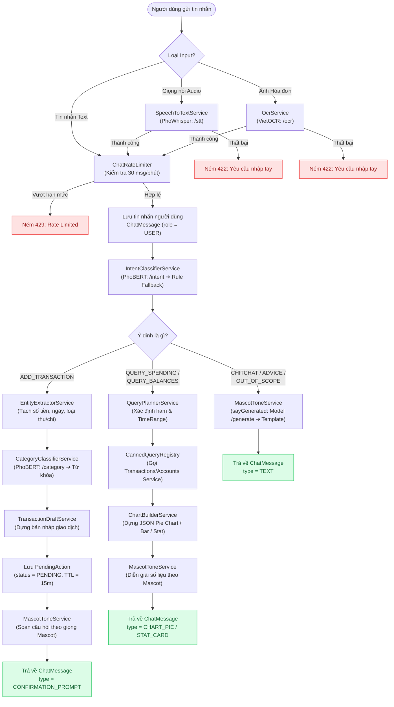
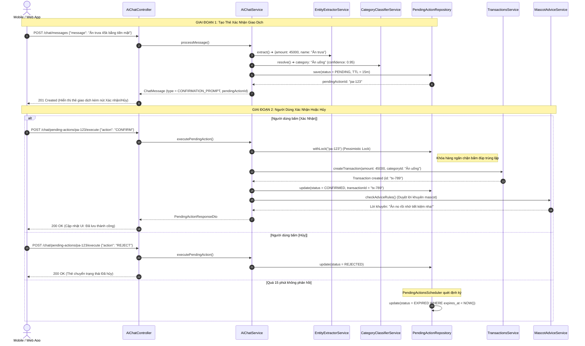
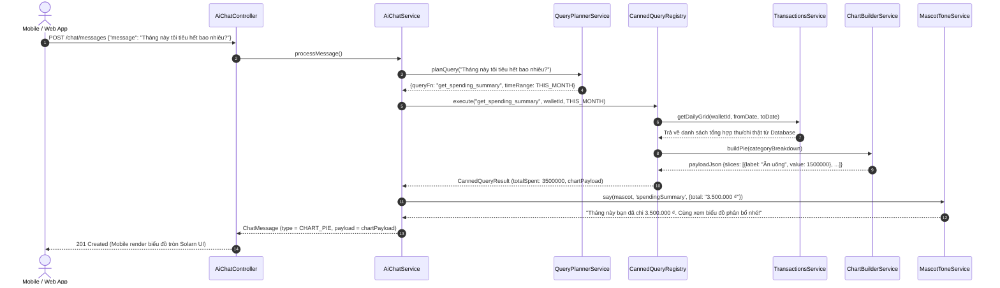
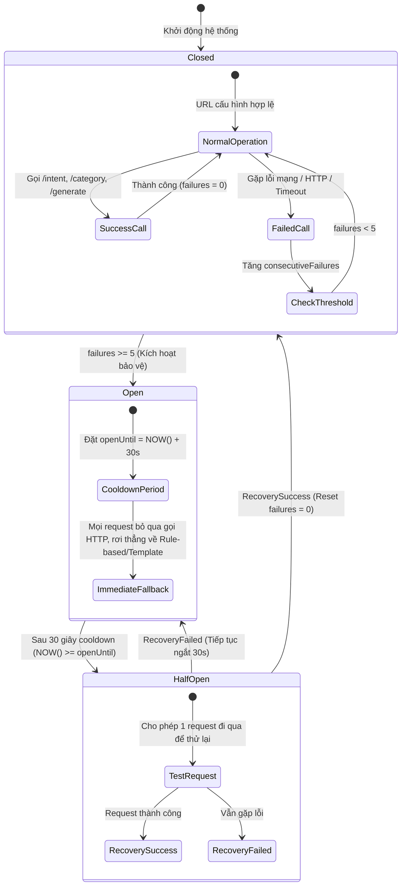

# Tổng quan toàn bộ các file trong Module `ai-chat`

Tài liệu này mô tả chi tiết chức năng, nhiệm vụ, đầu vào/đầu ra và mối quan hệ của **tất cả các tệp mã nguồn** trong module `ai-chat` (`finora_be/src/modules/ai-chat`).

---

## 📑 Mục Lục
- [1. Sơ đồ Cấu trúc Thư mục](#1-sơ-đồ-cấu-trúc-thư-mục)
- [2. Chi tiết từng Tệp Mã Nguồn](#2-chi-tiết-từng-tệp-mã-nguồn)
  - [2.1. Tầng Giao tiếp & Điều phối (Root)](#21-tầng-giao-tiếp--điều-phối-root)
  - [2.2. Tầng Quản lý Hằng số (`constants/`)](#22-tầng-quản-lý-hằng-số-constants)
  - [2.3. Tầng Xử lý Nghiệp vụ & NLP (`services/`)](#23-tầng-xử-lý-nghiệp-vụ--nlp-services)
  - [2.4. Tầng Truy cập Cơ sở Dữ liệu & Lưu trữ (`repositories/` & `entities/`)](#24-tầng-truy-cập-cơ-sở-dữ-liệu--lưu-trữ-repositories--entities)
  - [2.5. Tầng DTO & Mapper (`dto/`, `mapper/`, `enums/`, `exceptions/`, `utils/`)](#25-tầng-dto--mapper-dto-mapper-enums-exceptions-utils)
- [3. Các Sơ Đồ Luồng Hoạt Động (Mermaid Diagrams)](#3-các-sơ-đồ-luồng-hoạt-động-mermaid-diagrams)
  - [3.1. Sơ Đồ Luồng Tổng Quan End-to-End (Architecture & Pipeline)](#31-sơ-đồ-luồng-tổng-quan-end-to-end-architecture--pipeline)
  - [3.2. Sơ Đồ Tuần Tự: Ghi Chép Giao Dịch & Human-in-the-Loop](#32-sơ-đồ-tuần-tự-luồng-ghi-chép-giao-dịch--xác-nhận-2-bước-human-in-the-loop)
  - [3.3. Sơ Đồ Tuần Tự: Truy Vấn Số Liệu & Vẽ Biểu Đồ](#33-sơ-đồ-tuần-tự-luồng-truy-vấn-số-liệu-tài-chính--vẽ-biểu-đồ-canned-query)
  - [3.4. Sơ Đồ Model Gateway & Circuit Breaker](#34-sơ-đồ-cổng-kết-nối-model-gateway--circuit-breaker-modelgatewayservice)

---

## 1. Sơ đồ Cấu trúc Thư mục

```
ai-chat/
├── ai-chat.controller.ts                 # REST API endpoints (/chat/...)
├── ai-chat.module.ts                     # NestJS Module khai báo DI & imports
├── ai-chat.service.ts                    # Service chính điều phối luồng chat AI & pending actions
├── README.md                             # Hướng dẫn tích hợp tóm tắt
├── AI_CHAT_FILES_OVERVIEW.md             # [File này] Bản đồ chi tiết từng file
│
├── constants/                            # Thư mục quản lý toàn bộ hằng số của module
│   ├── ai-chat.constant.ts               # Các hằng số mặc định (TTL, hạn mức, mime type)
│   ├── category-keywords.constant.ts     # Từ điển regex / từ khóa tiếng Việt cho từng danh mục
│   ├── mascot-templates.constant.ts      # Các câu thoại mẫu của Nora, Leo, Miu, v.v.
│   ├── advice-rules.constant.ts          # Quy tắc sinh lời khuyên tài chính cho từng mascot
│   └── index.ts                          # Barrel export gom tất cả constants
│
├── dto/                                  # Data Transfer Objects
│   ├── request/
│   │   ├── chat-history-query.dto.ts     # Phân trang lịch sử tin nhắn (keyset beforeId, limit)
│   │   ├── execute-pending-action.dto.ts # Request xác nhận/từ chối hành động chờ + dữ liệu chỉnh sửa
│   │   ├── send-media-message.dto.ts     # Request gửi giọng nói / hóa đơn (multipart)
│   │   └── send-message.dto.ts           # Request gửi tin nhắn text thông thường
│   └── response/
│       ├── chat-message-response.dto.ts  # Response trả về tin nhắn chat (text, chart, preview card)
│       └── pending-action-response.dto.ts# Response thông tin hành động chờ xác nhận
│
├── entities/                             # TypeORM Database Entities
│   ├── chat-message.entity.ts            # Bảng lưu trữ lịch sử tin nhắn (vai trò, loại, payload JSON)
│   └── pending-action.entity.ts          # Bảng lưu hành động chờ duyệt (TTL 15 phút, khóa hàng)
│
├── enums/                                # Định nghĩa Enums
│   ├── ai-intent.enum.ts                 # Các intent: ADD_TRANSACTION, QUERY_SPENDING, CHITCHAT...
│   ├── chat-message-type.enum.ts         # Loại tin: TEXT, CONFIRMATION_PROMPT, CHART_PIE, STAT_CARD...
│   ├── chat-role.enum.ts                 # USER hoặc ASSISTANT
│   └── pending-action-status.enum.ts     # PENDING, CONFIRMED, REJECTED, EXPIRED
│
├── exceptions/                           # Ngoại lệ nghiệp vụ
│   └── ai-chat.exception.ts              # Danh sách custom HttpExceptions (400, 404, 409, 422, 503)
│
├── interfaces/                           # Kiểu dữ liệu & Type Definitions
│   └── ai-chat.types.ts                  # UploadedMedia, MascotCode, CategoryLite, Draft Types...
│
├── mapper/                               # Ánh xạ Entity -> DTO
│   └── ai-chat.mapper.ts                 # Chuyển đổi ChatMessage/PendingAction sang Response DTO
│
├── repositories/                         # Data Access Layer
│   ├── chat-message.repository.ts        # Lưu, truy vấn phân trang, xóa tin nhắn theo ví
│   └── pending-action.repository.ts      # Khóa bi quan (withLock), cập nhật trạng thái, hết hạn
│
├── schedulers/                           # Tác vụ định kỳ (Cron Jobs)
│   └── pending-actions.scheduler.ts      # Quét và đánh dấu EXPIRED cho pending action quá 15 phút
│
├── services/                             # Các dịch vụ xử lý nghiệp vụ & NLP
│   ├── canned-query.registry.ts          # Registry & xử lý 5 hàm truy vấn dữ liệu tài chính an toàn
│   ├── category-classifier.service.ts    # Phân loại danh mục (model NLP -> rule tiếng Việt)
│   ├── chart-builder.service.ts          # Format mảng số liệu thành cấu trúc Pie / Bar Chart
│   ├── chat-rate-limiter.service.ts      # Giới hạn tần suất gọi bot in-memory (chống spam)
│   ├── entity-extractor.service.ts       # Trích xuất số tiền, ngày, loại giao dịch bằng Regex
│   ├── intent-classifier.service.ts      # Phân loại ý định người dùng (PhoBERT -> Regex rules)
│   ├── mascot-advice.service.ts          # Chọn lời khuyên phù hợp theo mascot và giao dịch
│   ├── mascot-context.service.ts         # Xác định linh thú đang kích hoạt của người dùng
│   ├── mascot-tone.service.ts            # Tạo câu thoại theo phong cách linh thú (template hoặc AI sinh)
│   ├── model-gateway.service.ts          # Cổng giao tiếp HTTP tới AI Model Service (FastAPI) + Circuit Breaker
│   ├── ocr.service.ts                    # Trích xuất văn bản từ ảnh hóa đơn (VietOCR)
│   ├── query-planner.service.ts          # Phân tích text để chọn hàm truy vấn (Query function & TimeRange)
│   ├── speech-to-text.service.ts         # Chuyển đổi giọng nói thành text (PhoWhisper)
│   └── transaction-draft.service.ts      # Ghép nối trích xuất + danh mục + tài khoản thành bản nháp
│
└── utils/                                # Hàm tiện ích thuần túy
    ├── amount.parser.ts                  # Parser chuỗi tiền tệ tiếng Việt ("50k", "1 củ", "2 triệu rưỡi")
    ├── date.util.ts                      # Xử lý ngày giờ theo múi giờ Việt Nam (UTC+7, TimeRange)
    └── text.util.ts                      # Chuẩn hóa tiếng Việt bỏ dấu, format tiền tệ, cắt ngắn chuỗi
```

---

## 2. Chi tiết từng Tệp Mã Nguồn

### 2.1. Tầng Giao tiếp & Điều phối (Root)

#### [ai-chat.controller.ts](file:///f:/Project/FINORA/finora_be/src/modules/ai-chat/ai-chat.controller.ts)
- **Vai trò**: Cung cấp các HTTP REST API cho Client (Web / Mobile).
- **Các Endpoint**:
  - `POST /chat/messages`: Gửi tin nhắn text (hoặc kèm `intentOverride`).
  - `POST /chat/messages/media`: Gửi tệp âm thanh hoặc hình ảnh hóa đơn (multipart/form-data).
  - `GET /chat/messages`: Lấy lịch sử trò chuyện trong ví (phân trang keyset `beforeId`).
  - `GET /chat/pending-actions/:id`: Tra cứu chi tiết thẻ giao dịch chờ duyệt.
  - `POST /chat/pending-actions/:id/execute`: Xác nhận (`CONFIRM`) hoặc Từ chối (`REJECT`) lưu giao dịch.
  - `DELETE /chat/messages`: Xóa toàn bộ lịch sử trò chuyện trong ví.

#### [ai-chat.service.ts](file:///f:/Project/FINORA/finora_be/src/modules/ai-chat/ai-chat.service.ts)
- **Vai trò**: Orchestrator trung tâm của module.
- **Nhiệm vụ chính**:
  1. Điều phối luồng tin nhắn: Kiểm tra quyền ví, kiểm tra rate limit, nạp linh thú (mascot).
  2. Ghi nhận tin nhắn người dùng (`ChatRole.USER`) vào cơ sở dữ liệu.
  3. Định tuyến theo 5 Intent (`add_transaction`, `query_spending`, `chitchat`, `out_of_scope`, `intent_unclear`).
  4. Quản lý hành vi của `PendingAction`: Khóa dòng bằng `pendingActionRepo.withLock`, kiểm tra `validateDraft`, gọi `TransactionsService.createTransaction` khi người dùng bấm xác nhận.
  5. Xử lý ngoại lệ an toàn: Nếu xảy ra lỗi AI không mong muốn, tự động rơi về câu xin lỗi của Mascot (tránh 500 lỗi hệ thống).

#### [ai-chat.module.ts](file:///f:/Project/FINORA/finora_be/src/modules/ai-chat/ai-chat.module.ts)
- **Vai trò**: Khai báo NestJS Module.
- **Quan hệ**:
  - `imports`: `TypeOrmModule` (ChatMessage, PendingAction), `WalletsModule`, `AccountsModule`, `CategoriesModule`, `TransactionsModule`, `DashboardModule`, `MascotsModule`, `SettingsModule`.
  - `exports`: `AiChatService`, `CannedQueryRegistry`.

#### [ai-model.config.ts (tại `src/config/`)](file:///f:/Project/FINORA/finora_be/src/config/ai-model.config.ts)
- **Vai trò**: Cấu hình tập trung toàn hệ thống cho dịch vụ AI Model (`AI_MODEL_SERVICE_URL`, `AI_MODEL_SERVICE_KEY`, `AI_INTENT_THRESHOLD`, `AI_CATEGORY_THRESHOLD`, timeout, circuit breaker).

---

### 2.2. Tầng Quản lý Hằng số (`constants/`)

#### [constants/ai-chat.constant.ts](file:///f:/Project/FINORA/finora_be/src/modules/ai-chat/constants/ai-chat.constant.ts)
- Định nghĩa hằng số hoạt động: TTL 15 phút, giới hạn MB audio/ảnh, MIME types hợp lệ, giới hạn số tiền/ký tự, mã lỗi `AI_CHAT_ERROR_CODE`.

#### [constants/category-keywords.constant.ts](file:///f:/Project/FINORA/finora_be/src/modules/ai-chat/constants/category-keywords.constant.ts)
- Bộ từ điển regex tiếng Việt phong phú để nhận diện danh mục tài chính (Ăn uống, Mua sắm, Di chuyển, Hóa đơn, Tiền lương, v.v.).
- Dùng cho phương án rule-based fallback khi Model AI không khả dụng hoặc confidence thấp.

#### [constants/advice-rules.constant.ts](file:///f:/Project/FINORA/finora_be/src/modules/ai-chat/constants/advice-rules.constant.ts)
- Các luật sinh lời khuyên tài chính sau khi lưu giao dịch:
  - Cảnh báo chi tiêu quá lớn.
  - Nhắc nhở danh mục mua sắm / ăn vặt.
  - Khen ngợi khi có khoản thu nhập mới.

#### [constants/mascot-templates.constant.ts](file:///f:/Project/FINORA/finora_be/src/modules/ai-chat/constants/mascot-templates.constant.ts)
- Ngân hàng câu thoại mẫu của các linh thú (Nora, Leo, Miu, v.v.) cho các tình huống:
  - Chào hỏi (`greet`), xin lỗi khi lỗi (`error`), hỏi lại khi không hiểu (`unclear`).
  - Lời thoại xác nhận giao dịch (`confirm`), lưu thành công (`saved`), từ chối (`rejected`).
  - Báo cáo số dư (`balance`), thống kê chi tiêu (`spending`), so sánh kỳ (`compareUp`, `compareDown`).

#### [constants/index.ts](file:///f:/Project/FINORA/finora_be/src/modules/ai-chat/constants/index.ts)
- Barrel export tập trung tất cả constants trong module.

---

### 2.3. Tầng Dịch vụ Xử lý (`services/`)

#### [services/intent-classifier.service.ts](file:///f:/Project/FINORA/finora_be/src/modules/ai-chat/services/intent-classifier.service.ts)
- Phân loại ý định từ câu nói của người dùng:
  1. Gửi sang Model Gateway (PhoBERT) nếu có cấu hình.
  2. Fallback sang hệ thống Regex Rules: nhận diện từ khóa ngoài phạm vi (crypto, bóng đá, thời tiết), từ khóa truy vấn, lời chào, v.v.

#### [services/entity-extractor.service.ts](file:///f:/Project/FINORA/finora_be/src/modules/ai-chat/services/entity-extractor.service.ts)
- Phân tích cú pháp văn bản tự nhiên để trích xuất:
  - Số tiền (sử dụng `amount.parser.ts`).
  - Ngày giao dịch (hôm nay, hôm qua, ngày mai, ngày cụ thể `DD/MM`).
  - Loại giao dịch: Thu (`INCOME`) hay Chi (`EXPENSE`).
  - Tên giao dịch (loại bỏ các từ khóa thừa).

#### [services/category-classifier.service.ts](file:///f:/Project/FINORA/finora_be/src/modules/ai-chat/services/category-classifier.service.ts)
- Ánh xạ nội dung giao dịch vào danh mục cụ thể trong ví của người dùng:
  - Đối chiếu tên danh mục người dùng trực tiếp nhắc đến.
  - Gọi model NLP phân loại theo danh sách ứng viên (`candidates`).
  - Fallback theo bảng từ khóa [category-keywords.constant.ts](file:///f:/Project/FINORA/finora_be/src/modules/ai-chat/constants/category-keywords.constant.ts).

#### [services/transaction-draft.service.ts](file:///f:/Project/FINORA/finora_be/src/modules/ai-chat/services/transaction-draft.service.ts)
- Kết hợp `EntityExtractorService` + `CategoryClassifierService` + khớp tài khoản thanh toán (`matchAccount`) để tạo bản nháp giao dịch `TransactionDraftInput` hoàn chỉnh trước khi xin xác nhận.

#### [services/canned-query.registry.ts](file:///f:/Project/FINORA/finora_be/src/modules/ai-chat/services/canned-query.registry.ts)
- **Đã tích hợp với `DashboardService`**:
  - Thực thi 5 hàm truy vấn được phê duyệt:
    1. `GET_SPENDING_SUMMARY`: Tổng chi/thu, cơ cấu chi tròn.
    2. `GET_TOP_CATEGORIES`: Top danh mục chi nhiều nhất.
    3. `GET_WALLET_BALANCES`: Số dư từng tài khoản và tổng ví.
    4. `COMPARE_PERIODS`: So sánh chi tiêu kỳ này vs kỳ trước.
    5. `GET_RECENT_TRANSACTIONS`: Danh sách giao dịch gần nhất.
  - Sử dụng các câu truy vấn SQL tối ưu dưới cơ sở dữ liệu qua `DashboardService`.
  - Đóng gói dữ liệu kèm lời bình Mascot và cấu trúc biểu đồ.

#### [services/query-planner.service.ts](file:///f:/Project/FINORA/finora_be/src/modules/ai-chat/services/query-planner.service.ts)
- Xác định hàm truy vấn (`functionName`) và khoảng thời gian (`timeRange`) từ câu hỏi của người dùng (ví dụ: *"tháng này tiêu gì nhiều nhất"* -> `GET_TOP_CATEGORIES`, `THIS_MONTH`).

#### [services/chart-builder.service.ts](file:///f:/Project/FINORA/finora_be/src/modules/ai-chat/services/chart-builder.service.ts)
- Định dạng mảng số liệu thành cấu trúc JSON chuẩn cho biểu đồ tròn (`buildPie`), biểu đồ cột (`buildBar`), và biểu đồ so sánh (`buildComparison`).

#### [services/model-gateway.service.ts](file:///f:/Project/FINORA/finora_be/src/modules/ai-chat/services/model-gateway.service.ts)
- Quản lý kết nối HTTP ra microservice AI bên ngoài (FastAPI / HuggingFace).
- Tích hợp **Circuit Breaker**: Sau 5 lỗi liên tiếp sẽ tạm ngắt 30 giây để tránh làm nghẽn hệ thống.

#### [services/speech-to-text.service.ts](file:///f:/Project/FINORA/finora_be/src/modules/ai-chat/services/speech-to-text.service.ts)
- Gửi file ghi âm lên endpoint `/stt` (PhoWhisper) để chuyển đổi giọng nói thành văn bản. Nếu không nhận diện được sẽ ném ngoại lệ 422 `requireManualInput`.

#### [services/ocr.service.ts](file:///f:/Project/FINORA/finora_be/src/modules/ai-chat/services/ocr.service.ts)
- Gửi ảnh hóa đơn lên endpoint `/ocr` (VietOCR) để trích xuất nội dung hóa đơn.

#### [services/mascot-context.service.ts](file:///f:/Project/FINORA/finora_be/src/modules/ai-chat/services/mascot-context.service.ts)
- Xác định linh thú đang kích hoạt của người dùng (dựa trên cấp độ/cài đặt). Mặc định là `nora`.

#### [services/mascot-tone.service.ts](file:///f:/Project/FINORA/finora_be/src/modules/ai-chat/services/mascot-tone.service.ts)
- Trả về câu thoại mẫu có thay thế biến (`say`) hoặc gọi model sinh lời thoại linh động (`sayGenerated`).

#### [services/mascot-advice.service.ts](file:///f:/Project/FINORA/finora_be/src/modules/ai-chat/services/mascot-advice.service.ts)
- Duyệt qua [advice-rules.constant.ts](file:///f:/Project/FINORA/finora_be/src/modules/ai-chat/constants/advice-rules.constant.ts) để tìm lời khuyên tài chính thích hợp nhất sau khi lưu giao dịch.

#### [services/chat-rate-limiter.service.ts](file:///f:/Project/FINORA/finora_be/src/modules/ai-chat/services/chat-rate-limiter.service.ts)
- Quản lý giới hạn số lượng tin nhắn trong 1 phút của từng user (In-memory Rate Limiter) để chống spam.

---

### 2.4. Tầng Truy cập Cơ sở Dữ liệu & Lưu trữ (`repositories/` & `entities/`)

#### [entities/chat-message.entity.ts](file:///f:/Project/FINORA/finora_be/src/modules/ai-chat/entities/chat-message.entity.ts)
- Đại diện bảng lưu tin nhắn: `id`, `user_id`, `wallet_id`, `role` (USER/ASSISTANT), `message_type`, `text_content`, `intent`, `mascot`, `payload_json`, `created_at`.

#### [entities/pending-action.entity.ts](file:///f:/Project/FINORA/finora_be/src/modules/ai-chat/entities/pending-action.entity.ts)
- Đại diện bảng lưu hành động chờ duyệt: `id`, `user_id`, `wallet_id`, `tool_name`, `tool_input` (dữ liệu thô), `preview_payload` (thông tin hiển thị lên thẻ), `status`, `expires_at`, `chat_message_id`, `transaction_id`.

#### [repositories/chat-message.repository.ts](file:///f:/Project/FINORA/finora_be/src/modules/ai-chat/repositories/chat-message.repository.ts)
- Thao tác database: Tạo và lưu tin nhắn, lấy tin phân trang theo `walletId` và `beforeId`, xóa toàn bộ tin nhắn theo ví.

#### [repositories/pending-action.repository.ts](file:///f:/Project/FINORA/finora_be/src/modules/ai-chat/repositories/pending-action.repository.ts)
- Thao tác database với `PendingAction`:
  - `withLock`: Thực hiện khóa bi quan (`PESSIMISTIC_WRITE`) khi người dùng bấm xác nhận, ngăn chặn lỗi race condition (bấm đúp tạo 2 giao dịch trùng).
  - Cập nhật trạng thái `CONFIRMED`, `REJECTED`, `EXPIRED`.
  - Hủy các hành động chờ khi xóa ví/lịch sử.

#### [schedulers/pending-actions.scheduler.ts](file:///f:/Project/FINORA/finora_be/src/modules/ai-chat/schedulers/pending-actions.scheduler.ts)
- Cron job chạy định kỳ mỗi phút: Quét và cập nhật trạng thái `EXPIRED` cho các hành động chờ đã quá 15 phút.

---

### 2.5. Tầng DTO & Mapper (`dto/`, `mapper/`, `enums/`, `exceptions/`, `utils/`)

#### [dto/request/](file:///f:/Project/FINORA/finora_be/src/modules/ai-chat/dto/request)
- `send-message.dto.ts`: Chứa `walletId`, `message`, `source` tuỳ chọn, `intentOverride` tuỳ chọn.
- `send-media-message.dto.ts`: Chứa `walletId` khi gửi file âm thanh/ảnh.
- `execute-pending-action.dto.ts`: Chứa quyết định `action` (`CONFIRM` hoặc `REJECT`) và dữ liệu chỉnh sửa `editedData` (số tiền, ngày, danh mục, tài khoản, ghi chú).
- `chat-history-query.dto.ts`: Tham số `walletId`, `limit`, `beforeId`.

#### [dto/response/](file:///f:/Project/FINORA/finora_be/src/modules/ai-chat/dto/response)
- `chat-message-response.dto.ts`: DTO trả về cho client gồm `id`, `role`, `type`, `text`, `intent`, `mascot`, `payload`, `pendingAction` (nếu có).
- `pending-action-response.dto.ts`: DTO trả về trạng thái của hành động chờ kèm tin nhắn phản hồi của mascot.

#### [mapper/ai-chat.mapper.ts](file:///f:/Project/FINORA/finora_be/src/modules/ai-chat/mapper/ai-chat.mapper.ts)
- Chuyển đổi từ `ChatMessage` và `PendingAction` entity sang các Response DTO an toàn cho phía Client.

#### [exceptions/ai-chat.exception.ts](file:///f:/Project/FINORA/finora_be/src/modules/ai-chat/exceptions/ai-chat.exception.ts)
- Chứa toàn bộ ngoại lệ chuẩn hóa của module: `AiMediaRequiredException` (400), `AiUnsupportedMediaException` (400), `PendingActionNotFoundException` (404), `PendingActionAlreadyProcessedException` (409), `PendingActionExpiredException` (409), `AiSttFailedException` (422), `AiChatInvalidAmountException` (400)...

#### [utils/amount.parser.ts](file:///f:/Project/FINORA/finora_be/src/modules/ai-chat/utils/amount.parser.ts)
- Nhận diện linh hoạt cách diễn đạt số tiền tiếng Việt: `50k` (50,000), `1.5 củ` (1,500,000), `2 triệu rưỡi` (2,500,000), `3 trăm rưỡi` (350,000)...

#### [utils/date.util.ts](file:///f:/Project/FINORA/finora_be/src/modules/ai-chat/utils/date.util.ts)
- Đảm bảo toàn bộ tính toán ngày theo múi giờ `Asia/Ho_Chi_Minh` (UTC+7). Cung cấp hàm `resolveRange` biến đổi các enum `THIS_MONTH`, `LAST_MONTH`, `THIS_WEEK`, `TODAY` thành khoảng ngày `from...to` cụ thể.

#### [utils/text.util.ts](file:///f:/Project/FINORA/finora_be/src/modules/ai-chat/utils/text.util.ts)
- Hàm tiện ích: `normalizeForMatch` (chuyển chữ thường, bỏ dấu tiếng Việt), `formatMoney` (định dạng VND/tiền tệ), `containsPhrase`, `truncate`.

---

## 3. Các Sơ Đồ Luồng Hoạt Động (Mermaid Diagrams)

### 3.1. Sơ Đồ Luồng Tổng Quan End-to-End (Architecture & Pipeline)

Sơ đồ thể hiện hành trình từ khi người dùng gửi tin nhắn (Văn bản, Giọng nói, Hóa đơn) qua các tầng dịch vụ cho đến khi nhận được phản hồi:



---

### 3.2. Sơ Đồ Tuần Tự: Luồng Ghi Chép Giao Dịch & Xác Nhận 2 Bước (Human-in-the-Loop)

Để đảm bảo an toàn tài chính tuyệt đối, AI không bao giờ tự ý lưu giao dịch thật mà luôn thông qua cơ chế `PendingAction` với khóa bi quan (`PESSIMISTIC_WRITE`):



---

### 3.3. Sơ Đồ Tuần Tự: Luồng Truy Vấn Số Liệu Tài Chính & Vẽ Biểu Đồ (Canned Query)

Đảm bảo **zero-hallucination** (không có ảo giác số liệu): Toàn bộ số liệu tiền tệ do SQL/Database tính toán 100%, AI chỉ nhận nhiệm vụ diễn giải câu thoại:



---

### 3.4. Sơ Đồ Cổng Kết Nối Model Gateway & Circuit Breaker (`ModelGatewayService`)

Cơ chế phòng vệ tự động đảm bảo ứng dụng không bao giờ bị nghẽn mạng nếu dịch vụ AI gặp sự cố:


