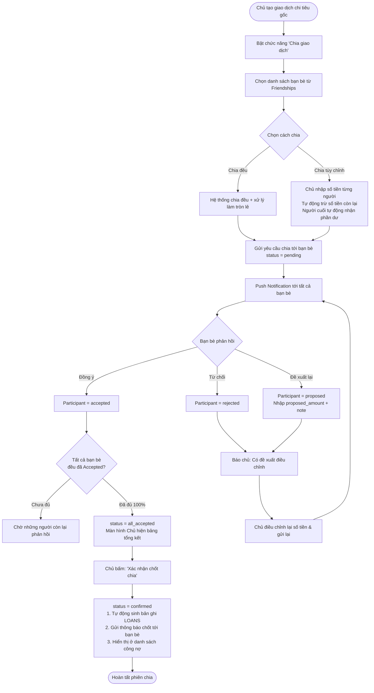

# Đặc tả Nghiệp vụ Tính năng Chia Giao Dịch (Split Expense) — FINORA

> **Tài liệu Phân tích Nghiệp vụ (Business Analysis - BA)**  
> **Dự án:** FINORA — Quản lý Tài chính Cá nhân & Xã hội  
> **Module:** 1.3: Split Expense (Chia hóa đơn / Chia tiền bạn bè)  
> **Người soạn thảo:** Đội ngũ Kiến trúc Hệ thống FINORA  
> **Phiên bản:** 1.0  
> **Ngày phê duyệt:** 2026-10-16  

---

## 1. Tổng quan & Mục tiêu Nghiệp vụ

### 1.1. Bối cảnh (Problem Statement)
Trong các hoạt động hàng ngày (đi ăn chung, du lịch, thuê nhà, sự kiện nhóm), một người thường đứng ra thanh toán toàn bộ hóa đơn bằng tài khoản/thẻ cá nhân. Sau đó, việc tính toán tiền của từng người, nhắn tin nhắc nợ và theo dõi ai đã trả thường gặp nhiều trở ngại:
- Ngại nhắc nợ trực tiếp vì lý do tế nhị.
- Không minh bạch số tiền cụ thể của từng người (người ăn ít, người uống nhiều).
- Khó theo dõi tổng số tiền bạn bè còn thiếu và lịch sử trả nợ.

### 1.2. Mục tiêu Giải pháp (Solution Objectives)
- **Minh bạch**: Cho phép chủ giao dịch chia đều hoặc chia tùy biến linh hoạt, hiển thị số tiền còn lại theo thời gian thực khi nhập liệu.
- **Dân chủ & Đồng thuận (Consensus)**: Bạn bè có quyền xem chi tiết, chấp nhận, từ chối hoặc đề xuất lại số tiền phù hợp trước khi giao dịch được chốt.
- **Tự động hóa sổ sách tài chính**: Khi tất cả đồng thuận và chủ giao dịch bấm chốt, hệ thống tự động sinh ra các khoản nợ ([`Loan`](file:///f:/Project/FINORA/finora_be/src/modules/loans/entities/loan.entity.ts)) tương ứng để theo dõi trả nợ mà không làm sai lệch báo cáo chi tiêu của từng cá nhân.

---

## 2. Các Tác nhân & Vai trò (Actors)

| Tác nhân | Vai trò trong phiên chia |
| :--- | :--- |
| **Chủ giao dịch (Owner / Payer)** | Người sở hữu giao dịch chi tiêu gốc (`Transaction`), là người thanh toán tiền ban đầu, khởi tạo phiên chia, điều chỉnh tỷ lệ và xác nhận chốt phiên. |
| **Người tham gia (Participant / Friend)** | Bạn bè trong hệ thống được chủ giao dịch chọn chia sẻ, nhận thông báo, duyệt/từ chối hoặc gửi đề xuất lại số tiền. |
| **Hệ thống (FINORA Core Engine)** | Tính toán phân bổ số tiền, gửi thông báo đẩy (Push Notifications), kiểm soát trạng thái đồng thuận và tự động tạo công nợ khi chốt. |

---

## 3. Quy trình Nghiệp vụ Chi tiết (Business Process)

---

## 4. Đặc tả Quy tắc Nghiệp vụ (Business Rules)

### 4.1. Quy tắc Phân bổ Số tiền & Làm tròn (Rounding Rule)
- **Quy tắc bảo toàn tổng tiền**: Tổng số tiền phân bổ cho tất cả người tham gia (bao gồm cả phần của chủ giao dịch nếu chủ tự chịu 1 phần) phải **chính xác bằng 100% số tiền của giao dịch gốc**:
  $$\sum_{i=1}^{n} \text{assigned\_amount}_i = \text{Transaction.amount}$$
- **Quy tắc làm tròn (Rounding Mechanism)**:
  - Khi chia đều: Số tiền tạm tính mỗi người = $\lfloor \text{Total} / n \rfloor$.
  - Số tiền dư do phép chia lẻ sẽ được tự động cộng dồn vào người cuối cùng trong danh sách.
  - *Ví dụ:* 100.000 VNĐ chia 3 người:
    - Người 1: 33.333 VNĐ
    - Người 2: 33.333 VNĐ
    - Người 3 (cuối cùng): $100.000 - 33.333 \times 2 = 33.334 \text{ VNĐ}$.
- **Quy tắc nhập tùy chỉnh Real-time**:
  - Giao diện cung cấp thanh tiến trình: `Số tiền còn lại để chia = Total - Đã phân bổ`.
  - Khi người dùng nhập số tiền cho người thứ $k$, hệ thống tự tính lại số tiền còn lại.
  - Người cuối cùng trong danh sách sẽ **bị khóa ô nhập** và tự động gán bằng toàn bộ số tiền còn lại.

### 4.2. Quy tắc Đề xuất lại (Counter-Proposal)
- Nếu bạn bè không đồng ý với mức phân bổ, người đó có quyền chọn hành động **"Đề xuất lại" (`PROPOSED`)**:
  - Bắt buộc nhập `proposedAmount`: Số tiền thực tế người đó đồng ý trả.
  - Tùy chọn nhập `note`: Lý do đề xuất (ví dụ: *"Hôm nay mình ăn chay chỉ gọi rau 30k"*).
- Khi có đề xuất, phiên chia chưa thể hoàn tất. Chủ giao dịch nhận được thông báo phản hồi và có thể:
  1. Chấp nhận đề xuất: Hệ thống điều chỉnh lại mức chia của bạn đó và cộng/trừ phần chênh lệch vào phần của chủ hoặc những người còn lại.
  2. Từ chối đề xuất: Giữ nguyên hoặc trao đổi lại qua chat trực tiếp ([`DirectMessage`](file:///f:/Project/FINORA/finora_be/src/modules/messages/entities/direct-message.entity.ts)).

### 4.3. Quy tắc Đồng thuận Tuyệt đối (100% Consensus)
- Giao dịch **chỉ được phép chuyển sang trạng thái sẵn sàng chốt (`all_accepted`)** khi và chỉ khi:
  $$\forall \text{participant} \in \text{Participants}: \text{status} = \text{'accepted'}$$
- Một người bất kỳ ở trạng thái `pending`, `proposed` hoặc `rejected` đều ngăn chặn việc chốt phiên.

### 4.4. Cơ chế Tự động Hạch toán Công nợ ([`LOANS`](file:///f:/Project/FINORA/finora_be/src/modules/loans/entities/loan.entity.ts))
Khi chủ giao dịch bấm nút **"Xác nhận chốt chia"**:
1. Trạng thái của `EXPENSE_SPLITS` chuyển sang `confirmed`.
2. Đối với mỗi người bạn tham gia:
   - Hệ thống tự động tạo 1 bản ghi nợ trong bảng `LOANS`:
     - `walletId`: Ví chứa giao dịch gốc của chủ.
     - `counterpartyUserId`: ID của người bạn tham gia.
     - `counterpartyName`: Tên của người bạn.
     - `type`: `LoanType.LENT` (về phía chủ là khoản cho vay / phải thu).
     - `principalAmount`: `assignedAmount` đã chốt.
     - `startDate`: Ngày diễn ra giao dịch gốc.
     - `note`: `Chia hóa đơn: <Ghi chú giao dịch gốc>`.
     - `status`: `LifecycleStatus.ACTIVE`.
   - Cập nhật trường `loanId` trong `SPLIT_PARTICIPANTS` để liên kết chéo.
3. Khi người bạn chuyển tiền trả lại cho chủ:
   - Người bạn hoặc chủ ghi nhận trả nợ qua [`LoanPayment`](file:///f:/Project/FINORA/finora_be/src/modules/loans/entities/loan-payment.entity.ts).
   - Khi khoản nợ được trả hết $\rightarrow$ cờ `isSettled` trong `SPLIT_PARTICIPANTS` tự động chuyển thành `true`.

---

## 5. Cấu trúc Mô hình Dữ liệu (Data Model)

### 5.1. Bảng `EXPENSE_SPLITS`
Lưu trữ thông tin phiên chia tiền gắn với giao dịch gốc:

| Cột | Kiểu dữ liệu | Ràng buộc | Mô tả |
| :--- | :--- | :--- | :--- |
| `id` | UUID | PK | Khóa chính phiên chia |
| `transaction_id` | UUID | FK $\rightarrow$ TRANSACTIONS, UNIQUE | Giao dịch gốc được chia (quan hệ 1 - 1) |
| `wallet_id` | UUID | FK $\rightarrow$ WALLETS | Ví thanh toán gốc |
| `created_by_id` | UUID | FK $\rightarrow$ USERS | Người tạo (chủ giao dịch) |
| `total_amount` | Decimal(15,2) | NOT NULL | Tổng số tiền chia |
| `split_type` | Enum | `equal`, `custom`, `percentage` | Phương thức chia |
| `status` | Enum | `pending`, `all_accepted`, `confirmed`, `cancelled` | Trạng thái phiên |
| `created_at` | Timestamp | NOT NULL | Thời điểm khởi tạo |
| `updated_at` | Timestamp | NOT NULL | Thời điểm cập nhật cuối |

### 5.2. Bảng `SPLIT_PARTICIPANTS`
Lưu danh sách và phản hồi của từng người bạn tham gia:

| Cột | Kiểu dữ liệu | Ràng buộc | Mô tả |
| :--- | :--- | :--- | :--- |
| `id` | UUID | PK | Khóa chính người tham gia |
| `split_id` | UUID | FK $\rightarrow$ EXPENSE_SPLITS | Thuộc phiên chia nào (CASCADE on delete) |
| `user_id` | UUID | FK $\rightarrow$ USERS | Người bạn được chia |
| `assigned_amount` | Decimal(15,2) | NOT NULL | Số tiền được phân bổ |
| `proposed_amount` | Decimal(15,2) | NULLABLE | Số tiền đề xuất lại nếu muốn sửa |
| `status` | Enum | `pending`, `accepted`, `rejected`, `proposed` | Trạng thái phê duyệt của bạn |
| `note` | Text | NULLABLE | Lý do đề xuất lại hoặc từ chối |
| `loan_id` | UUID | FK $\rightarrow$ LOANS, NULLABLE | Khoản nợ tự động sinh ra sau khi chốt |
| `is_settled` | Boolean | DEFAULT FALSE | Đã thanh toán nợ cho chủ xong chưa |
| `created_at` | Timestamp | NOT NULL | Thời điểm thêm vào phiên |
| `updated_at` | Timestamp | NOT NULL | Thời điểm phản hồi |

---

## 6. Danh mục API RESTful (Endpoints)

| STT | Phương thức | Đường dẫn API | Mô tả nghiệp vụ |
| :---: | :---: | :--- | :--- |
| 1 | `POST` | `/api/v1/transactions/{id}/splits` | Khởi tạo phiên chia tiền (chọn bạn bè, kiểu chia đều/tùy chỉnh) |
| 2 | `GET` | `/api/v1/transactions/{id}/splits` | Lấy thông tin chi tiết phiên chia và trạng thái từng bạn bè |
| 3 | `PUT` | `/api/v1/splits/{splitId}/rebalance` | Chủ giao dịch cập nhật lại tỉ lệ chia sau khi có phản hồi |
| 4 | `POST` | `/api/v1/splits/{splitId}/respond` | Bạn bè gửi phản hồi (`accepted`, `rejected` hoặc `proposed` kèm số tiền đề xuất) |
| 5 | `POST` | `/api/v1/splits/{splitId}/confirm` | Chủ giao dịch xác nhận chốt phiên $\rightarrow$ Tự động sinh `LOANS` |
| 6 | `DELETE`| `/api/v1/splits/{splitId}` | Chủ giao dịch hủy phiên chia tiền |

---

## 7. Các kịch bản Ngoại lệ (Exceptions & Edge Cases)

1. **Giao dịch gốc bị xóa trong lúc phiên chia đang `pending`**:
   - Khóa ngoại `onDelete: 'CASCADE'` trên `transactionId` sẽ tự động hủy phiên chia và gửi thông báo hủy tới các bạn bè liên quan.
2. **Bạn bè chưa cài app hoặc chưa có tài khoản FINORA**:
   - Tính năng Split Expense trong phạm vi này áp dụng cho bạn bè đã có tài khoản FINORA (thông qua hệ thống bạn bè `FRIENDSHIPS`). Đối với người ngoài, chủ giao dịch sử dụng tính năng tạo khoản nợ thủ công [`Loan`](file:///f:/Project/FINORA/finora_be/src/modules/loans/entities/loan.entity.ts) với `counterpartyName`.
3. **Người tham gia đã trả tiền mặt ngay tại chỗ**:
   - Chủ giao dịch có thể đánh dấu trực tiếp `isSettled = true` cho người đó ngay khi chốt phiên mà không cần tạo nhắc nợ.
